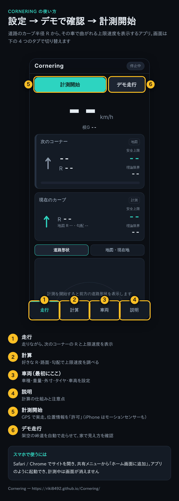
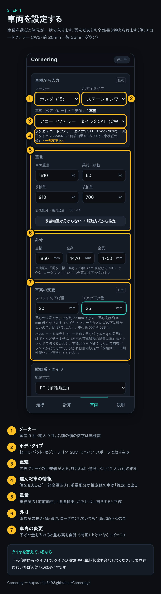
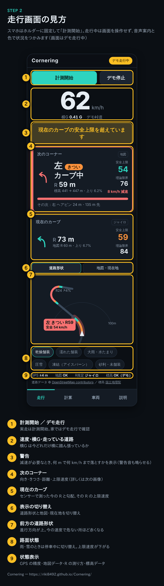
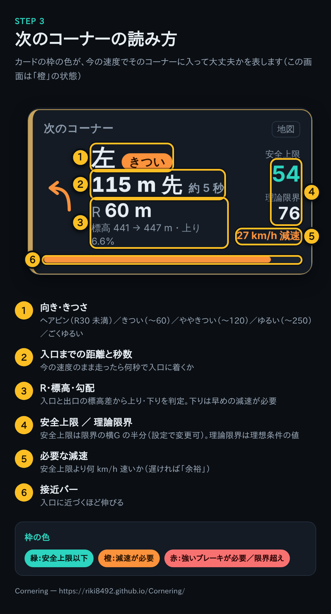
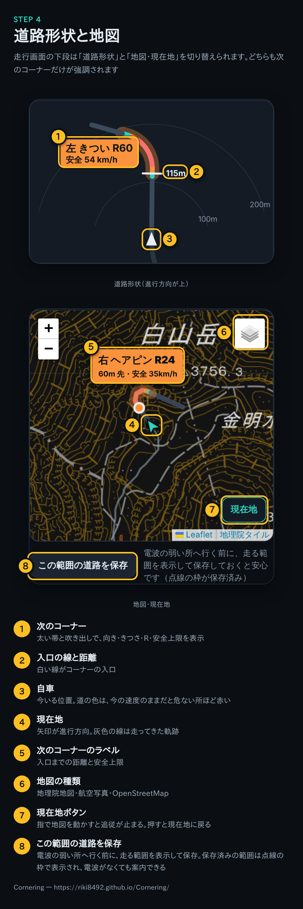
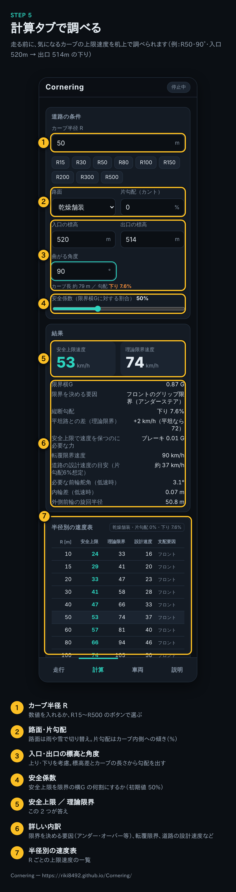
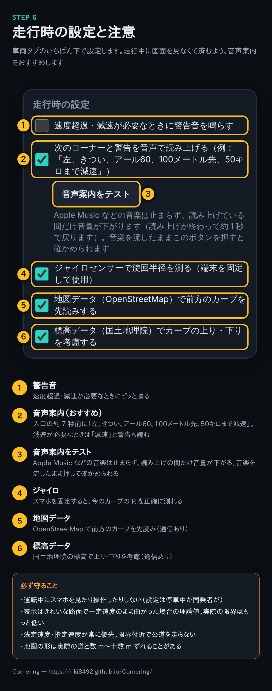

# Cornering

走行中の道路のカーブ半径 R から、**その車で曲がれる上限速度**をリアルタイムに表示する Web アプリ（PWA）です。
車種・年式・グレードの選択は不要で、**車両重量・前後軸重・全幅・全高・全長・駆動方式・タイヤ**だけから計算します。

ビルド不要の静的サイトなので、GitHub Pages などに置けばスマートフォンのブラウザでそのまま使えます。

**アプリ：https://riki8492.github.io/Cornering/**

## 使い方

### スマホで開く

1. 上の URL を Safari（iPhone）か Chrome（Android）で開き、共有メニューから**「ホーム画面に追加」**。アプリのように起動でき、計測中は画面が消えません
2. 「計測開始」を押したら位置情報を**「許可」**。iPhone はモーションセンサー（ジャイロ）の許可も求められるので許可します
3. 最初は家で「デモ走行」を動かして、見え方と音声案内を確認しておくと安心です

### 画像で見る使い方

実際のアプリ画面に番号と説明を付けた解説です（例の車両はアコードツアラー CW2・前 20mm／後 25mm ダウン）。

#### 全体の流れ — 設定 → デモで確認 → 計測開始



#### STEP 1 車両を設定する

メーカー → ボディタイプ → 車種で選ぶと諸元が一括で入ります。車検証の軸重や車高の変更があれば上書きします。



#### STEP 2 走行画面の見方

スマホはホルダーに固定して「計測開始」。走行中は画面を操作せず、音声案内と色で状況をつかみます。



#### STEP 3 次のコーナーの読み方

カードの枠の色が、今の速度でそのコーナーに入って大丈夫かを表します（緑：安全上限以下／橙：減速が必要／赤：強いブレーキが必要かカーブの中で限界超え）。



#### STEP 4 道路形状と地図

走行画面の下段は「道路形状」と「地図・現在地」を切り替えられます。どちらも次のコーナーだけが強調されます。



#### STEP 5 計算タブで調べる

走る前に、気になるカーブの上限速度を机上で調べられます。



#### STEP 6 走行時の設定と注意

車両タブのいちばん下で設定します。走行中に画面を見なくて済むよう、音声案内がおすすめです。



## できること

| 画面 | 内容 |
| --- | --- |
| 走行 | GPS・ジャイロで「いま曲がっているカーブ」の R を計測し、OpenStreetMap の道路形状から「この先のカーブ」の R と距離、国土地理院の標高から入口・出口の標高と勾配を先読み。安全上限速度・理論限界速度を表示し、減速が必要なら警告（音も可）。下段は「道路形状」と「地図・現在地」（現在地・軌跡・この先の道路とカーブの R を地図に表示）を切り替え。次のコーナーは向き・きつさ・距離・秒数・必要な減速を大きく表示し、緑／橙／赤で状況を示す。道路形状と地図でも次のコーナーだけを強調し、音声案内（任意）で入口の約 7 秒前に読み上げ |
| 計算 | 任意の R・路面・片勾配・入口/出口の標高に対する上限速度、限界を決める要因、転覆限界、道路構造令上の設計速度、低速時の舵角・内輪差。半径別の速度表 |
| 車両 | 車両諸元の入力（人気車種のプルダウンから一括入力も可）と、そこから推定した計算用パラメータの確認・上書き |
| デモ走行 | 架空の峠道を自動で走らせて、机上で動作を確認できます |

## 入力する車両諸元

| 項目 | 使いみち |
| --- | --- |
| 車両重量・乗員/積載 | 総重量。タイヤの荷重感度（重いほど μ が下がる）に効く |
| 前軸重・後軸重 | 前後それぞれの軸の荷重と必要横力。片方を入れるともう片方は自動補完。分からなければ駆動方式から推定 |
| 全幅 | トレッドを推定（全幅 × 0.86）→ 横方向の荷重移動・転覆限界 |
| 全高 | 重心高を推定（0.42 × 全高 − 0.06 m）→ 荷重移動・転覆限界、Cd・前面投影面積 → 空気抵抗。ローダウンしていても純正の値を入れる |
| 車高の変更（前・後の下げ量） | 重心の前後位置でのボディの下がり量（前後の下げ量を軸重比で内分）× ばね上の割合 0.87 だけ重心高を下げる。上げた場合はマイナス |
| 全長 | ホイールベースを推定 → 低速時の舵角・内輪差・最小回転半径の判定 |
| 駆動方式・LSD | 速度維持に必要な駆動力が駆動輪の摩擦円を消費。オープンデフでは荷重の抜けた内輪の空転を判定 |
| タイヤの種類・幅・摩耗 | 路面別のピーク μ、荷重感度、コーナリング抵抗（ピークスリップ角） |

推定値（トレッド・重心高・ホイールベース・最小回転半径・Cd・前面投影面積・ロール剛性配分）は「詳細設定」で実測値やカタログ値に上書きできます。

バネレートや減衰力は入力項目にありません。一定速で回り続けるときの左右の荷重移動の総量は「重さ × 横G × 重心高 ÷ トレッド」で決まり、バネの硬さは関係しないためです。前後どちらを硬くしたかで前後バランスが変わるので、分かる場合は「前輪側ロール剛性配分」で調整します。

### 車種プリセット（任意）

「車両」タブ先頭で**メーカー → ボディタイプ → 車種**の順に絞り込んで選ぶと、代表グレードの諸元が一括で入ります（選んだあとも自由に変更でき、変更すると「一部変更あり」と表示）。18 メーカー・93 車種。

| メーカー | 車種 |
| --- | --- |
| トヨタ | ヤリス、アクア、カローラ スポーツ、カローラ、プリウス、カムリ、クラウン クロスオーバー、ヤリス クロス、カローラ クロス、RAV4、ハリアー、ランドクルーザー、アルファード、ノア / ヴォクシー、シエンタ、GR86、GRヤリス、GRカローラ、GRスープラ、AE86 |
| レクサス | IS |
| ホンダ | フィット、シビック、アコード、ヴェゼル、ZR-V、ステップワゴン、フリード、N-BOX、N-ONE RS、シビック タイプR（FL5・EK9）、インテグラ タイプR、S660、S2000、アコードツアラー（CW2） |
| 日産 | ノート、ノート オーラ NISMO、スカイライン 400R、キックス、エクストレイル、セレナ、フェアレディZ、GT-R、スカイラインGT-R（BNR34）、シルビア（S15） |
| マツダ | デミオ、MAZDA2、MAZDA3、MAZDA6 ワゴン、CX-3、CX-5、CX-60、ロードスター（ND・NA）、RX-8、RX-7（FD3S） |
| スバル | インプレッサ スポーツ、レヴォーグ、フォレスター、XV、BRZ、WRX S4、WRX STI（VAB）、インプレッサ WRX STI（GDB）、レガシィツーリングワゴン（BR9） |
| スズキ | スイフト、スイフトスポーツ、ワゴンR、ハスラー、ジムニー、ジムニーシエラ、アルトワークス |
| ダイハツ | タント、コペン、ロッキー |
| 三菱 | デリカ D:5、アウトランダー PHEV、ランエボ IX・X |
| 輸入車 | VW ポロ・ゴルフ GTI、MINI クーパーS、BMW 3シリーズ・M2、メルセデス・ベンツ Cクラス、ポルシェ 911 GT3・911 カレラ・718 ケイマン GTS、フォード マスタング GT、シボレー コルベット、ロータス エリーゼ、アルピーヌ A110 |

ボディタイプは軽自動車／コンパクト・ハッチバック／セダン／ステーションワゴン／SUV／ミニバン／スポーツの 7 種類で、GRヤリス（コンパクトかつスポーツ）のように複数に属する車はどちらで絞っても出てきます。

値は公称値・一般に知られている値をもとにした**目安**で、年式・グレード・オプション・仕向け地で変わります。前後の重量配分が公表されていない車は駆動方式とレイアウトから推定し、画面に「推定」と表示します。前後でタイヤサイズが違う車はタイヤ幅を平均値にし、4WD の前後駆動配分は選択肢の中で近いものに割り当て、パートタイム 4WD（ジムニーなど）は舗装路で使う 2WD（2H）として扱います。正確な値は車検証で確認してください。車種の追加は `js/presets.js` に1件足すだけです。

## 計算モデル

定常円旋回で、次の条件をすべて満たす最大速度を二分法で求めています。

1. **前後各軸のグリップ**：各軸は自分の軸重ぶんの横力を受け持つ（定常旋回のモーメント釣り合い）。
   各輪のグリップは `Fy_max = μ0 · Fz · (Fz / Fz0)^-k`（荷重感度）。横方向荷重移動 `ΔW = m·a·h / t` を前後ロール剛性配分で振り分けるので、重心が高い・トレッドが狭いほど内輪が抜けて総グリップが減る
2. **駆動輪の摩擦円**：空気抵抗 `½ρCdAv²`＋転がり抵抗＋コーナリング抵抗 `Fy·sin(α_peak)` を駆動輪が負担し、その分だけ横に使えるグリップが減る（4WD は前後で分担）
3. **転覆**：横加速度/法線加速度が `SSF × 0.88`（SSF = トレッド / 2·重心高、0.88 はロールによる重心移動ぶん）を超えない
4. **片勾配**：路面の傾き θ による法線力・横力の変化を考慮
5. **縦断勾配**（入口と出口の標高差 ÷ カーブ長）：重力の進行方向成分 `m·g·sinφ` を上りは駆動輪、下りはブレーキ（前軸重比 +10% の前寄り配分）が負担。
   前後の荷重移動 `ΔW = (空気抵抗 + m·g·sinφ)·h / WB` で上りはフロント、下りはリアが抜ける。横力の前後分担は重心位置で決まるので静的配分のまま

緩い下りでは一定速を保つための駆動力を重力が肩代わりするため、定常旋回の限界はほとんど変わりません（FF ではわずかに上がることもあります）。
下りコーナーで厳しくなるのは進入時の減速とアクセルを抜いても速度が落ちないことなので、走行画面の減速警告ではカーブまでの平均勾配ぶんの制動力を上乗せしています。

- **安全上限速度** = 理論限界の横G に安全係数（既定 50%）を掛けた速度
- **設計速度の目安** = 道路構造令の `R = V² / 127(i + f)` を逆算（片勾配未入力なら i = 6%）

### R の求め方（走行中）

- **この先のカーブ**：Overpass API で周辺の道路を取得 → 現在地と進行方位でマップマッチング（一方通行の反対車線は除外）→ 道なりに最大 700 m 先読み → 5 m 間隔に再サンプリングし、前後 15 m の 3 点円で曲率を計算
- **入口・出口の標高**：[国土地理院 標高タイル](https://maps.gsi.go.jp/development/demtile.html)（DEM10B、ズーム14）を道路に沿って 5 m 間隔で引き、±15 m で平滑化。橋・トンネル（OSM の `bridge` / `tunnel` タグ）は地表の標高が使えないので前後から直線補間。地理院タイルが無い国外などは [AWS Terrain Tiles](https://registry.opendata.aws/terrain-tiles/)（Terrarium）を使用
- **現在のカーブ**：ジャイロのヨーレート ω から `R = v / ω`（端末の向きに依存しないよう重力方向まわりの角速度を使用）。ジャイロが無ければ GPS 進行方位の変化率、それも無ければ GPS 軌跡への円フィッティング

## 開発・公開

### GitHub Pages で公開する

位置情報・モーションセンサーは **https でしか使えません**。

1. GitHub のリポジトリ設定 → Pages → Source を「Deploy from a branch」、ブランチ `main`・フォルダ `/ (root)` を選んで保存
2. 数分で `https://<ユーザー名>.github.io/Cornering/` が使えるようになる（無料プランでは公開リポジトリのみ）

### ローカルで動かす

```sh
npm start        # python3 -m http.server 8000
# → http://localhost:8000/ （PC の localhost なら位置情報も使えます）
npm test         # 物理モデル・幾何・マップマッチングなどのテスト（Node.js 18+）
npm run guide    # 使い方の解説画像（docs/guide/）を作り直す（Playwright が必要）
```

解説画像は `tools/guide/make-guide.cjs` が実際のアプリをヘッドレスブラウザで操作して撮影し、番号と説明を重ねて作っています。画面を変えたら `npm run guide` で作り直してください。

## ファイル構成

```
index.html            画面
css/style.css
js/physics.js         車両モデル・上限速度の計算（DOM 非依存）
js/geo.js             座標変換・円フィッティング・曲率プロファイル
js/roadmap.js         OSM 道路網・マップマッチング・先読み
js/elevation.js       標高タイルの取得・デコード、道路沿いの標高プロファイル
js/sensors.js         GPS / ジャイロから速度・方位・旋回半径を推定
js/sim.js             デモ走行
js/presets.js         人気車種の諸元プリセット
js/mapview.js         地図・現在地の表示（Leaflet）
js/corner.js          次のコーナーのきつさ分類・接近の状況・音声案内の文言
vendor/leaflet/       Leaflet 1.9.4（BSD-2-Clause、LICENSE 同梱）
js/app.js             UI
sw.js                 オフライン用 Service Worker
tests/                node:test によるテスト
docs/guide/           使い方の解説画像
tools/guide/          解説画像を作るスクリプト（npm run guide）
```

## 注意

- 表示される限界速度は**理想的な定常旋回の理論値**です。路面の凹凸、ブレーキング中の旋回、横風、車両の状態、運転操作で実際の限界は大きく下がります
- 地図の形状は実際の道路と数 m〜十数 m ずれることがあり、R の誤差になります。交差点では最も直進に近い道を「道なり」とみなします
- 法定速度・指定速度が常に優先です。限界付近の速度で公道を走らないでください
- 運転中にスマートフォンを注視・操作しないでください。端末はホルダーに固定し、設定は停車中か同乗者が行ってください

道路データ © [OpenStreetMap contributors](https://www.openstreetmap.org/copyright)（ODbL）／ 標高データ：国土地理院 標高タイル、AWS Terrain Tiles ／ 地図：地理院タイル、OpenStreetMap ／ 地図ライブラリ：[Leaflet](https://leafletjs.com/)
